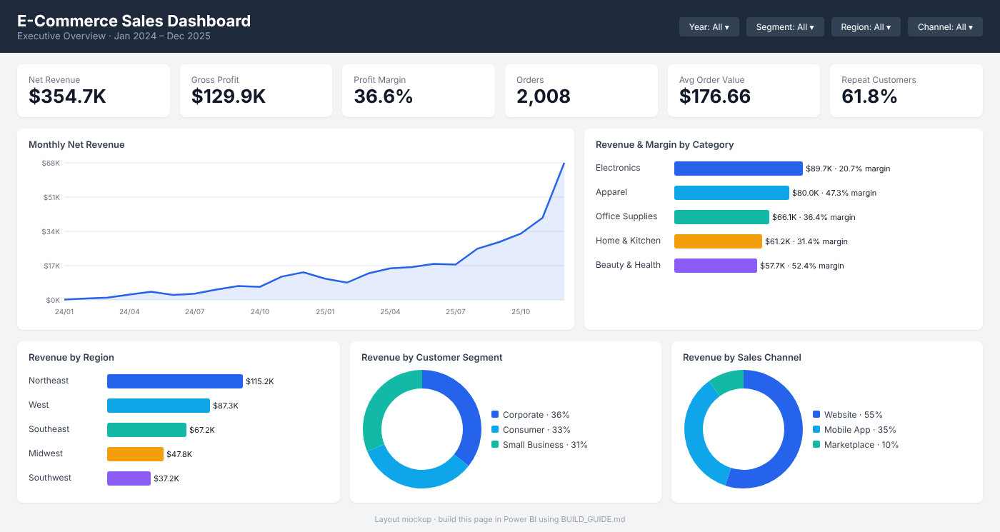

# 📊 E-Commerce Sales Dashboard (Power BI)

**An interactive executive dashboard tracking revenue, profit, products and customers for an online retailer (Jan 2024 – Dec 2025).**


> This is the visualization companion to my
> [**E-Commerce Sales Analysis with SQL**](https://github.com/mihiritankar-tech/ecommerce-sales-sql-analysis) project. It uses the same dataset, and the dashboard KPIs match the SQL results.

<!-- After building in Power BI, replace the image below with your real screenshots:


-->


---

## 📌 Business Goal
Give leadership a **single, interactive view** of business performance so they can:
- Track revenue, profit and order KPIs at a glance
- Spot trends and seasonality month by month
- Compare categories, regions, segments and sales channels
- Identify where profit is lost (low-margin products, discounts, returns)

## 🗂️ Data Model (Star Schema)

```
                 ┌────────────┐
                 │  products  │
                 └─────┬──────┘
                       │ 1
┌──────────┐ 1   *┌────┴────────┐*   1┌──────────┐ *   1┌───────────┐
│   Date   ├──────┤ order_items ├─────┤  orders  ├──────┤ customers │
└──────────┘      └─────────────┘     └──────────┘      └───────────┘
   (via orders[order_date])
```

| Table | Rows | Type |
|---|---|---|
| `order_items` | 3,452 | Fact |
| `orders` | 2,252 | Fact / header |
| `customers` | 800 | Dimension |
| `products` | 40 | Dimension |
| `Date` | 731 | Dimension (DAX calendar) |

## 📐 Key DAX Measures
All measures are in [`dax/measures.dax`](dax/measures.dax). Highlights:

```dax
Net Revenue =
CALCULATE (
    SUMX ( order_items, order_items[quantity] * order_items[unit_price] * ( 1 - order_items[discount] ) ),
    orders[status] = "Delivered"
)

Revenue YoY % = DIVIDE ( [Net Revenue] - [Revenue PY], [Revenue PY] )

Repeat Customer % =
VAR Buyers  = FILTER ( VALUES ( customers[customer_id] ), [Total Orders] >= 1 )
VAR Repeats = FILTER ( Buyers, [Total Orders] > 1 )
RETURN DIVIDE ( COUNTROWS ( Repeats ), COUNTROWS ( Buyers ) )
```

**Skills shown:** `CALCULATE` filter context · iterators (`SUMX`, `RELATED`) · time intelligence (`SAMEPERIODLASTYEAR`, `DATEADD`, `TOTALYTD`) · variables (`VAR`/`RETURN`) · safe division (`DIVIDE`)

## 📄 Dashboard Pages
| Page | What it answers |
|---|---|
| **1. Executive Overview** | How much are we selling and earning? How is it trending? |
| **2. Product Performance** | Which products drive revenue vs. profit? How do discounts affect margin? |
| **3. Customers & Operations** | Who are our best customers? How many come back? Where do we lose revenue to returns? |

Every page can be filtered by **Year, Segment, Region and Channel**.

## 📊 Key Insights
| KPI | Value |
|---|---|
| Net Revenue | **$354.7K** |
| Gross Profit | **$129.9K** (36.6% margin) |
| Orders | 2,008 |
| Avg Order Value | $176.66 |
| Repeat Customers | 61.8% |

- 📈 **Revenue grew 5x from 2024 to 2025**, and **Nov–Dec bring in 38%** of annual revenue.
- 💻 **Electronics leads in revenue ($89.7K) but has the lowest margin (20.7%)**. Beauty & Health earns 52.4%.
- 🏢 **Corporate customers are 12% of buyers but 36% of revenue.**
- 🗺️ **Northeast is the top region (32.5%)**, and the Southwest is the weakest (10.5%).
- 🏷️ **Margin falls from 39.8% to 25.3%** as discounts go from 0% to 20%.

## 💡 Recommendations
1. Build a **B2B / Corporate account program** to grow the highest-value segment.
2. Run **retention campaigns**: 38% of customers bought only once.
3. **Promote high-margin categories** and review Electronics pricing and supplier costs.
4. **Cap discounts at 10%**, and prepare inventory for the **Q4 peak**.

## ▶️ How to Use
- **View:** open `ecommerce_sales_dashboard.pbix` in [Power BI Desktop](https://powerbi.microsoft.com/desktop/) (free).
- **Rebuild from scratch:** follow [`BUILD_GUIDE.md`](BUILD_GUIDE.md).

## 📁 Project Structure
```
├── data/                 # 4 CSV source tables
├── dax/measures.dax      # All DAX measures + Date table
├── images/               # Dashboard screenshots
├── BUILD_GUIDE.md        # Step-by-step build instructions
└── ecommerce_sales_dashboard.pbix   # Power BI file
```

---

👤 **Mihir Itankar**, Business Analyst
[LinkedIn](https://www.linkedin.com/in/mihiritankar-mba) · [GitHub](https://github.com/mihiritankar-tech)
